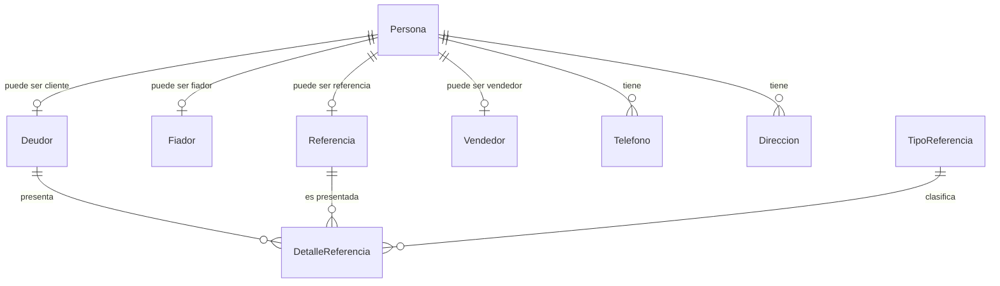
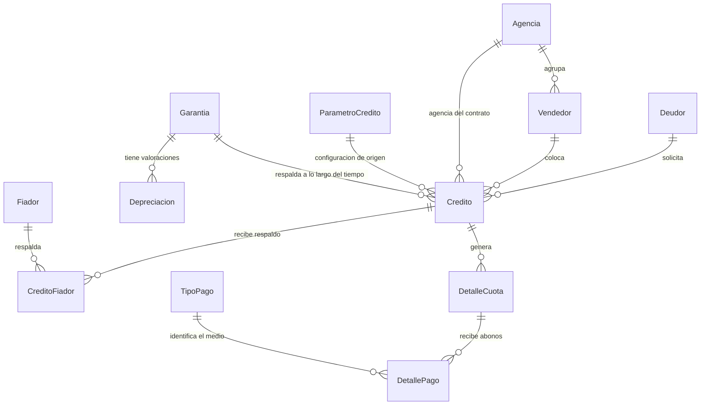
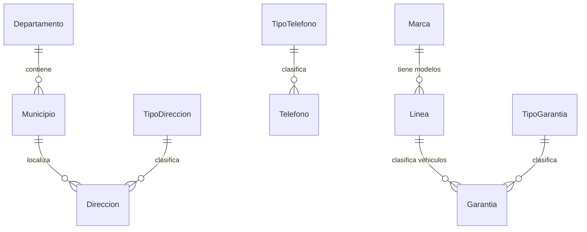

# Fase 2 — Modelo entidad-relación de MAGIS-AUTO

Fecha: 8 de octubre de 2026. Trabajo individual de Diego en la rama pruebas-diego.
Estado: aprobado por Diego para continuar a la Fase 3. Este documento describe la versión de 25 tablas; los ajustes de normalización se proponen por separado en FASE_3_Modelo_Relacional_3FN.md. No se modificó la base instalada en esta fase.

## Propósito y alcance

Este modelo representa clientes y referencias, vehículos, créditos y fiadores, vendedores y comisiones, planes de cuotas y pagos. Parte de los conceptos del archivo del ingeniero y corresponde a las 25 tablas de la entrega SQL ampliada. El modelo no demuestra que el instalador ya se haya ejecutado: la base local mantiene por separado la estructura anterior.

Las cinco entidades añadidas frente a las 20 originales son Agencia, Fiador, CreditoFiador, ParametroCredito y Depreciacion. También se ajustan entidades existentes: DetalleReferencia ahora relaciona referencias con clientes; Garantia unifica VIN/chasis; los contratos guardan condiciones y los pagos guardan su desglose.

Una entidad representa algo que debemos registrar. PK es la llave que identifica una fila. FK enlaza una fila con otra entidad. Una PK compuesta identifica mediante varios campos juntos. 1:N significa uno a muchos; N:M, muchos a muchos. Los códigos correlativos pueden tener saltos y no deben interpretarse como conteos.

## 1. Personas, clientes y referencias

Cada registro de Deudor, Fiador, Referencia o Vendedor corresponde exactamente a una Persona. Una Persona puede tener como máximo un registro de cada rol y combinar roles. La misma persona puede ser cliente de un crédito y fiador de otro; no de su propio crédito.

Las referencias se asocian al cliente, no a cada crédito. Una misma persona de referencia puede ser presentada por distintos clientes; el parentesco depende de cada vínculo. El cliente en preparación puede tener de cero a muchas referencias, pero antes de aprobar un crédito se exigen al menos tres distintas y completas. El modelo 0:N permite ese registro por etapas; la regla mínima se valida al aprobar.

DPI y NIT son únicos cuando existen. Los exige el rol de cliente o fiador, pero no una referencia personal. Correo compartido permitido. La fecha de nacimiento del cliente permite el reporte de cumpleaños y su carta. Los datos de contacto se guardan en Persona, Telefono y Direccion, no se repiten en cada rol.

## 2. Créditos, garantías y recaudación

Todo crédito pertenece exactamente a un cliente, un vehículo y un vendedor. También conserva la agencia del contrato, que no tiene que cambiar si el vendedor se traslada de agencia después. El vehículo puede aparecer en varios créditos históricos, pero como máximo en uno VIGENTE. La mora no libera esa garantía.

La relación crédito-fiador es N:M mediante CreditoFiador. Se exige un fiador por defecto cuando corresponde; el comité puede indicar cero o una cantidad mayor. El número de asignaciones debe satisfacer FiadoresRequeridos antes de aprobar.

El crédito BORRADOR puede no tener cuotas; al aprobar tendrá exactamente tantas como indique Plazo. Cada cuota corresponde a un crédito. La pareja (NumeroCredito, Cuota) la identifica: cuota 1 de un contrato es distinta de cuota 1 de otro.

Cada pago se aplica exactamente a una cuota, mediante esa misma pareja como FK. Una cuota admite cero, uno o varios pagos. El pago completo y los abonos parciales usan la misma entidad; no se guardan listas de pagos dentro de la cuota.

## 3. Catálogos y localización

Municipio se identifica por (CodigoDepartamento, CodigoMunicipio), y Direccion referencia ambos campos. Linea se identifica por (CodigoMarca, CodigoLinea), y Garantia referencia ambos. Así no se admite una combinación inexistente de departamento/municipio ni de marca/línea. Los catálogos restantes aparecen en los diagramas anteriores.

## 4. Diccionario completo de entidades y atributos

Este listado registra los campos de la propuesta SQL para que ninguno quede fuera de la revisión. Los tipos y la normalización se justificarán en la Fase 3. `NULL` significa ausencia de dato; no equivale a una cadena vacía ni a espacios. La tabla Persona admite datos que dependen del rol, pero los procedimientos del paquete SQL exigen los requisitos del cliente, fiador o vendedor. La nulabilidad de la tabla no autoriza una operación incompleta. Las condiciones siguientes corresponden al diseño preparado, no a una instalación ya aplicada en la base local.

### 1. Departamento

Catálogo de departamentos para localizar direcciones.

PK: `CodigoDepartamento`.

| Campo | Tipo propuesto | Significado técnico / obligatoriedad |
|---|---|---|
| `CodigoDepartamento` | `int` | PK; Obligatorio |
| `Descripcion` | `nvarchar(128)` | Obligatorio |

### 2. Municipio

Municipios identificados dentro de su departamento.

PK: `CodigoDepartamento`, `CodigoMunicipio`.

| Campo | Tipo propuesto | Significado técnico / obligatoriedad |
|---|---|---|
| `CodigoDepartamento` | `int` | PK; Obligatorio; FK → Departamento.CodigoDepartamento |
| `CodigoMunicipio` | `int` | PK; Obligatorio |
| `Descripcion` | `nvarchar(128)` | Obligatorio |

### 3. TipoTelefono

Clasifica teléfonos como celular, casa o trabajo.

PK: `CodigoTipoTelefono`.

| Campo | Tipo propuesto | Significado técnico / obligatoriedad |
|---|---|---|
| `CodigoTipoTelefono` | `int` | PK; Obligatorio |
| `Descripcion` | `nvarchar(128)` | Obligatorio |

### 4. TipoDireccion

Clasifica direcciones particulares, laborales u otras.

PK: `CodigoTipoDireccion`.

| Campo | Tipo propuesto | Significado técnico / obligatoriedad |
|---|---|---|
| `CodigoTipoDireccion` | `int` | PK; Obligatorio |
| `Descripcion` | `nvarchar(128)` | Obligatorio |

### 5. TipoGarantia

Clasifica la garantía vehicular; el alcance actual solo admite vehículos nuevos de agencia.

PK: `CodigoTipoGarantia`.

| Campo | Tipo propuesto | Significado técnico / obligatoriedad |
|---|---|---|
| `CodigoTipoGarantia` | `int` | PK; Obligatorio |
| `Descripcion` | `nvarchar(128)` | Obligatorio |

### 6. TipoReferencia

Clasifica la relación de una referencia con el cliente.

PK: `CodigoTipoReferencia`.

| Campo | Tipo propuesto | Significado técnico / obligatoriedad |
|---|---|---|
| `CodigoTipoReferencia` | `int` | PK; Obligatorio |
| `Descripcion` | `nvarchar(128)` | Obligatorio |

### 7. TipoPago

Define los cinco medios de pago y si requieren referencia bancaria.

PK: `CodigoTipoPago`.

| Campo | Tipo propuesto | Significado técnico / obligatoriedad |
|---|---|---|
| `CodigoTipoPago` | `int` | PK; Obligatorio |
| `Descripcion` | `nvarchar(128)` | Obligatorio |
| `RequiereReferencia` | `bit` | Obligatorio |

### 8. Marca

Catálogo de marcas, cada una con código interno único.

PK: `CodigoMarca`.

| Campo | Tipo propuesto | Significado técnico / obligatoriedad |
|---|---|---|
| `CodigoMarca` | `int` | PK; Obligatorio |
| `Descripcion` | `nvarchar(128)` | Obligatorio |

### 9. Linea

Líneas/modelos comerciales de cada marca.

PK: `CodigoMarca`, `CodigoLinea`.

| Campo | Tipo propuesto | Significado técnico / obligatoriedad |
|---|---|---|
| `CodigoMarca` | `int` | PK; Obligatorio; FK → Marca.CodigoMarca |
| `CodigoLinea` | `int` | PK; Obligatorio |
| `Descripcion` | `nvarchar(128)` | Obligatorio |

### 10. Agencia

Agencias y su región; se relaciona con vendedores y contratos.

PK: `CodigoAgencia`.

| Campo | Tipo propuesto | Significado técnico / obligatoriedad |
|---|---|---|
| `CodigoAgencia` | `int` | PK; Correlativo automático; Obligatorio |
| `Nombre` | `nvarchar(128)` | Obligatorio |
| `Region` | `nvarchar(128)` | Obligatorio |

### 11. Persona

Datos comunes de las personas, sin duplicarlos por cada rol.

PK: `CodigoPersona`.

| Campo | Tipo propuesto | Significado técnico / obligatoriedad |
|---|---|---|
| `CodigoPersona` | `int` | PK; Correlativo automático; Obligatorio |
| `DPI` | `varchar(13)` | Admite `NULL` para una referencia; obligatorio al registrar cliente, fiador o vendedor. Único cuando existe; 13 dígitos. |
| `NIT` | `varchar(20)` | Admite `NULL` para roles que no lo requieren; obligatorio al registrar cliente o fiador. Único cuando existe. |
| `PrimerNombre` | `nvarchar(64)` | Obligatorio |
| `SegundoNombre` | `nvarchar(64)` | Opcional: `NULL` si la persona no tiene segundo nombre. |
| `PrimerApellido` | `nvarchar(64)` | Obligatorio |
| `SegundoApellido` | `nvarchar(64)` | Opcional: `NULL` si la persona no tiene segundo apellido. |
| `FechaNacimiento` | `date` | Obligatoria para clientes, para el reporte de cumpleaños; opcional para los demás roles. |
| `Genero` | `char(1)` | Opcional; heredado del modelo del ingeniero. El PDF y los 20 reportes acordados no lo exigen. |
| `CorreoElectronico` | `nvarchar(254)` | Obligatorio al registrar cliente o fiador; opcional en otros roles. Se permite compartir correo. |

DPI y NIT tienen índices únicos filtrados para admitir referencias sin esos documentos, evitando duplicados cuando sí existen. El correo no es único.

### 12. Telefono

Permite varios teléfonos por persona y por tanto por cliente, referencia o fiador.

PK: `CodigoPersona`, `Correlativo`.

| Campo | Tipo propuesto | Significado técnico / obligatoriedad |
|---|---|---|
| `CodigoPersona` | `int` | PK; Obligatorio; FK → Persona.CodigoPersona |
| `Correlativo` | `smallint` | PK; Obligatorio |
| `CodigoTipoTelefono` | `int` | Obligatorio; FK → TipoTelefono.CodigoTipoTelefono |
| `Numero` | `varchar(32)` | Obligatorio |

### 13. Direccion

Permite varias direcciones por persona con su municipio y tipo.

PK: `CodigoPersona`, `Correlativo`.

| Campo | Tipo propuesto | Significado técnico / obligatoriedad |
|---|---|---|
| `CodigoPersona` | `int` | PK; Obligatorio; FK → Persona.CodigoPersona |
| `Correlativo` | `smallint` | PK; Obligatorio |
| `CodigoTipoDireccion` | `int` | Obligatorio; FK → TipoDireccion.CodigoTipoDireccion |
| `CodigoDepartamento` | `int` | Obligatorio |
| `CodigoMunicipio` | `int` | Obligatorio |
| `Detalle` | `nvarchar(300)` | Obligatorio |

FK compuesta: `(CodigoDepartamento,CodigoMunicipio)` → `Municipio(CodigoDepartamento,CodigoMunicipio)`.

### 14. Deudor

Rol de cliente que solicita créditos; CodigoDeudor es su código interno correlativo.

PK: `CodigoDeudor`.

| Campo | Tipo propuesto | Significado técnico / obligatoriedad |
|---|---|---|
| `CodigoDeudor` | `int` | PK; Correlativo automático; Obligatorio |
| `CodigoPersona` | `int` | Obligatorio; FK → Persona.CodigoPersona; Único |

### 15. Referencia

Rol de referencia personal, con lugar de trabajo. No es un fiador.

PK: `CodigoReferencia`.

| Campo | Tipo propuesto | Significado técnico / obligatoriedad |
|---|---|---|
| `CodigoReferencia` | `int` | PK; Correlativo automático; Obligatorio |
| `CodigoPersona` | `int` | Obligatorio; FK → Persona.CodigoPersona; Único |
| `LugarTrabajo` | `nvarchar(200)` | Obligatorio |

### 16. DetalleReferencia

Asocia un cliente con una referencia concreta y su parentesco o relación.

PK: `CodigoDeudor`, `CodigoReferencia`.

| Campo | Tipo propuesto | Significado técnico / obligatoriedad |
|---|---|---|
| `CodigoDeudor` | `int` | PK; Obligatorio; FK → Deudor.CodigoDeudor |
| `CodigoReferencia` | `int` | PK; Obligatorio; FK → Referencia.CodigoReferencia |
| `CodigoTipoReferencia` | `int` | Obligatorio; FK → TipoReferencia.CodigoTipoReferencia |
| `ParentescoRelacion` | `nvarchar(100)` | Obligatorio |

### 17. Fiador

Rol de codeudor que puede respaldar distintos créditos.

PK: `CodigoFiador`.

| Campo | Tipo propuesto | Significado técnico / obligatoriedad |
|---|---|---|
| `CodigoFiador` | `int` | PK; Correlativo automático; Obligatorio |
| `CodigoPersona` | `int` | Obligatorio; FK → Persona.CodigoPersona; Único |

### 18. Vendedor

Empleado responsable de colocar el crédito, con persona y agencia.

PK: `CodigoVendedor`.

| Campo | Tipo propuesto | Significado técnico / obligatoriedad |
|---|---|---|
| `CodigoVendedor` | `int` | PK; Correlativo automático; Obligatorio |
| `CodigoEmpleado` | `varchar(30)` | Obligatorio; Único |
| `CodigoPersona` | `int` | Obligatorio; FK → Persona.CodigoPersona; Único |
| `CodigoAgencia` | `int` | Obligatorio; FK → Agencia.CodigoAgencia |

### 19. Garantia

Vehículo nuevo identificado por VIN/chasis, con marca, línea, año y precio.

PK: `CodigoGarantia`.

| Campo | Tipo propuesto | Significado técnico / obligatoriedad |
|---|---|---|
| `CodigoGarantia` | `int` | PK; Correlativo automático; Obligatorio |
| `VIN` | `varchar(17)` | Obligatorio; Único |
| `CodigoMarca` | `int` | Obligatorio |
| `CodigoLinea` | `int` | Obligatorio |
| `Anio` | `smallint` | Obligatorio |
| `ValorAgencia` | `decimal(18,2)` | Obligatorio |
| `Placa` | `varchar(20)` | Opcional mientras el vehículo no la tenga, conforme al PDF. Única cuando se registra. |
| `CodigoTipoGarantia` | `int` | Obligatorio; FK → TipoGarantia.CodigoTipoGarantia |
| `EsNuevo` | `bit` | Obligatorio |

FK compuesta: `(CodigoMarca,CodigoLinea)` → `Linea(CodigoMarca,CodigoLinea)`.

VIN es único. Placa también es única cuando se registra; puede permanecer vacía hasta que exista.

### 20. ParametroCredito

Configuración para preparar nuevos contratos; las condiciones aplicadas se conservan en cada crédito.

PK: `CodigoParametro`.

| Campo | Tipo propuesto | Significado técnico / obligatoriedad |
|---|---|---|
| `CodigoParametro` | `int` | PK; Correlativo automático; Obligatorio |
| `Nombre` | `nvarchar(100)` | Obligatorio |
| `Activo` | `bit` | Obligatorio |
| `TasaAnual` | `decimal(9,6)` | Obligatorio |
| `ManejoMensual` | `decimal(18,2)` | Obligatorio |
| `TasaSeguroAuto` | `decimal(9,6)` | Obligatorio |
| `TasaSeguroVida` | `decimal(9,6)` | Obligatorio |
| `EngancheMinimo` | `decimal(9,6)` | Obligatorio |
| `ComisionPredeterminada` | `decimal(9,6)` | Obligatorio |
| `DepreciacionInicial` | `decimal(9,6)` | Obligatorio |

Solo una configuración puede estar Activa a la vez. Los valores aplicados se copian al contrato para conservar sus condiciones aunque después cambie la configuración.

### 21. Credito

Contrato, condiciones financieras, responsables, estado y totales proyectados.

PK: `NumeroCredito`.

| Campo | Tipo propuesto | Significado técnico / obligatoriedad |
|---|---|---|
| `NumeroCredito` | `varchar(20)` | PK; Obligatorio |
| `CodigoDeudor` | `int` | Obligatorio; FK → Deudor.CodigoDeudor |
| `CodigoGarantia` | `int` | Obligatorio; FK → Garantia.CodigoGarantia |
| `CodigoVendedor` | `int` | Obligatorio; FK → Vendedor.CodigoVendedor |
| `CodigoAgencia` | `int` | Obligatorio; FK → Agencia.CodigoAgencia |
| `CodigoParametro` | `int` | Obligatorio; FK → ParametroCredito.CodigoParametro |
| `Plazo` | `smallint` | Obligatorio |
| `PrecioContado` | `decimal(18,2)` | Obligatorio |
| `Enganche` | `decimal(18,2)` | Obligatorio |
| `MontoFinanciado` | `Derivado` | Calculado: `CONVERT(decimal(18,2),PrecioContado-Enganche)` |
| `EngancheMinimo` | `decimal(9,6)` | Obligatorio |
| `TasaAnual` | `decimal(9,6)` | Obligatorio |
| `ManejoMensual` | `decimal(18,2)` | Obligatorio |
| `TasaSeguroAuto` | `decimal(9,6)` | Obligatorio |
| `TasaSeguroVida` | `decimal(9,6)` | Obligatorio |
| `PorcentajeComision` | `decimal(9,6)` | Obligatorio |
| `FiadoresRequeridos` | `smallint` | Obligatorio |
| `Estado` | `varchar(10)` | Obligatorio |
| `FechaAprobacion` | `datetime2(0)` | Sin dato en borrador; obligatoria al aprobar. Se conserva si el crédito se anula posteriormente. |
| `AprobadoPor` | `nvarchar(100)` | Sin dato en borrador; obligatorio al aprobar. Registra al responsable declarado del comité. |
| `TotalIntereses` | `decimal(18,2)` | Obligatorio |
| `TotalNetoRecaudable` | `decimal(18,2)` | Obligatorio |
| `FechaAnulacion` | `datetime2(0)` | Sin dato si no se ha anulado; obligatoria al anular. Se conserva para consultas históricas. |
| `MotivoAnulacion` | `nvarchar(300)` | Sin dato si no se ha anulado; obligatorio y no vacío al anular. |
| `AnuladoPor` | `nvarchar(100)` | Sin dato si no se ha anulado; obligatorio y no vacío al anular. |

Un índice único filtrado limita a un crédito VIGENTE por CodigoGarantia. BORRADOR, LIQUIDADO y ANULADO no ocupan esa condición. Plazo queda limitado a 12, 24, 36, 48 o 60 meses.

### 22. CreditoFiador

Tabla intermedia para la relación muchos-a-muchos entre créditos y fiadores.

PK: `NumeroCredito`, `CodigoFiador`.

| Campo | Tipo propuesto | Significado técnico / obligatoriedad |
|---|---|---|
| `NumeroCredito` | `varchar(20)` | PK; Obligatorio; FK → Credito.NumeroCredito |
| `CodigoFiador` | `int` | PK; Obligatorio; FK → Fiador.CodigoFiador |

### 23. Depreciacion

Historial de valoraciones del vehículo; no altera el capital que debe el cliente.

PK: `CodigoDepreciacion`.

| Campo | Tipo propuesto | Significado técnico / obligatoriedad |
|---|---|---|
| `CodigoDepreciacion` | `int` | PK; Correlativo automático; Obligatorio |
| `CodigoGarantia` | `int` | Obligatorio; FK → Garantia.CodigoGarantia |
| `FechaValoracion` | `date` | Obligatorio |
| `ValorOriginal` | `decimal(18,2)` | Obligatorio |
| `Porcentaje` | `decimal(9,6)` | Obligatorio |
| `ValorDepreciado` | `Derivado` | Calculado: `CONVERT(decimal(18,2),ROUND(ValorOriginal*(1-Porcentaje),2))` |
| `Observacion` | `nvarchar(300)` | Obligatorio |

### 24. DetalleCuota

Cada obligación mensual del plan, con fecha y desglose completo.

PK: `NumeroCredito`, `Cuota`.

| Campo | Tipo propuesto | Significado técnico / obligatoriedad |
|---|---|---|
| `NumeroCredito` | `varchar(20)` | PK; Obligatorio; FK → Credito.NumeroCredito |
| `Cuota` | `smallint` | PK; Obligatorio |
| `FechaVencimiento` | `date` | Obligatorio |
| `Capital` | `decimal(18,2)` | Obligatorio |
| `Interes` | `decimal(18,2)` | Obligatorio |
| `ManejoCuenta` | `decimal(18,2)` | Obligatorio |
| `SeguroAuto` | `decimal(18,2)` | Obligatorio |
| `SeguroVida` | `decimal(18,2)` | Obligatorio |
| `Total` | `Derivado` | Calculado: `CONVERT(decimal(18,2),Capital+Interes+ManejoCuenta+SeguroAuto+SeguroVida)` |

### 25. DetallePago

Cada pago o abono efectivo aplicado a una cuota, con desglose y datos de anulación.

PK: `CodigoPago`.

| Campo | Tipo propuesto | Significado técnico / obligatoriedad |
|---|---|---|
| `CodigoPago` | `bigint` | PK; Correlativo automático; Obligatorio |
| `Comprobante` | `bigint` | Obligatorio; Único |
| `NumeroCredito` | `varchar(20)` | Obligatorio |
| `Cuota` | `smallint` | Obligatorio |
| `FechaPago` | `datetime2(0)` | Obligatorio |
| `CodigoTipoPago` | `int` | Obligatorio; FK → TipoPago.CodigoTipoPago |
| `ReferenciaBancaria` | `nvarchar(100)` | Opcional en efectivo; obligatoria y no vacía para depósito, ACH y tarjetas, según los cinco medios configurados. |
| `Monto` | `decimal(18,2)` | Obligatorio |
| `Capital` | `decimal(18,2)` | Obligatorio |
| `Interes` | `decimal(18,2)` | Obligatorio |
| `ManejoCuenta` | `decimal(18,2)` | Obligatorio |
| `SeguroAuto` | `decimal(18,2)` | Obligatorio |
| `SeguroVida` | `decimal(18,2)` | Obligatorio |
| `PorcentajeComision` | `decimal(9,6)` | Obligatorio |
| `Comision` | `Derivado` | Calculado: `CONVERT(decimal(18,2),ROUND(Monto*PorcentajeComision,2))` |
| `RegistradoPor` | `nvarchar(100)` | Obligatorio |
| `FechaAnulacion` | `datetime2(0)` | Sin dato si no se ha anulado; obligatoria al anular. Se conserva para consultas históricas. |
| `MotivoAnulacion` | `nvarchar(300)` | Sin dato si no se ha anulado; obligatorio y no vacío al anular. |
| `AnuladoPor` | `nvarchar(100)` | Sin dato si no se ha anulado; obligatorio y no vacío al anular. |
| `Observacion` | `nvarchar(300)` | Opcional para un pago; puede ser `NULL` si no hay una aclaración adicional. |

FK compuesta: `(NumeroCredito,Cuota)` → `DetalleCuota(NumeroCredito,Cuota)`.

## 5. Campos derivados, historial y reglas

- MontoFinanciado = PrecioContado − Enganche.
- Total de cuota = Capital + Interes + ManejoCuenta + SeguroAuto + SeguroVida.
- Saldo de cuota a una fecha = Total − suma de pagos efectivos a esa fecha. Es una consulta calculada; no otra tabla ni un campo editable que pueda quedar desactualizado.
- Comision = Monto del pago × PorcentajeComision, redondeada a centavos. No se necesita una entidad Comision independiente para el alcance aprobado: no llevamos todavía desembolsos al vendedor. Los reportes distinguen generación y reversión según las fechas.
- ValorDepreciado = ValorOriginal × (1 − Porcentaje). Una nueva valoración se guarda como una nueva fila, no como descuento sobre la deuda.
- TotalIntereses y TotalNetoRecaudable se fijan al generar el contrato, conforme al plan. El segundo es la interpretación académica acordada de suma de cuotas completas, sin enganche ni descuento de comisiones; no representa ganancia.
- Las tasas, precios y agencia guardados en Credito son condiciones del contrato, no copias que deban sincronizarse con valores actuales. La Fase 3 explicará estos datos históricos y los totales derivados, sin afirmar que toda repetición equivale automáticamente a 3FN.
- Los responsables de aprobación/anulación se registran como texto mientras el inicio de sesión sea opcional. Sin autenticación, ese texto no verifica la identidad real.
- Registro de varios contactos: se puede preparar una Persona sin contactos, pero la aprobación exige los contactos establecidos para cliente, referencias y fiadores.
- Borrados físicos de registros sin dependencias; pagos financieros se conservan y se anulan con fecha, motivo y responsable. Esto es la interpretación de trabajo pendiente de validar con el ingeniero frente al requisito académico de borrar por entidad.

## 6. Ejemplo de recorrido

1. Registrar a Ana en Persona, su teléfono y su dirección.
2. Crear su rol Deudor y vincular tres referencias completas mediante DetalleReferencia.
3. Registrar un vehículo en Garantia, con VIN, línea/marca, año y precio.
4. Preparar el crédito con cliente, vendedor, agencia, plazo, enganche y condiciones.
5. Asociar el fiador requerido mediante CreditoFiador, si corresponde.
6. Aprobar: validar requisitos, generar exactamente N cuotas y registrar valoración inicial.
7. Registrar un abono en DetallePago para una cuota. El saldo disminuye por lo efectivamente pagado y se genera la comisión correspondiente.
8. Si hay saldo vencido al corte, el crédito aparece en mora; si se liquida todo el plan, cambia a LIQUIDADO.

## 7. Acuerdo sobre campos opcionales y condicionales

Decisión de Diego: conservar los campos opcionales justificados y exigir los datos del PDF según el rol y la operación. No convertir todos los campos a NOT NULL, porque obligaría a inventar placas, segundos nombres o anulaciones inexistentes.

- Datos personales: los procedimientos de Deudor, Fiador y Vendedor comprueban la identificación que corresponde. Persona_Actualizar impide quitar los datos obligatorios de un rol existente.
- Aprobación: Credito_Aprobar exige datos del cliente, contactos, tres referencias completas y los fiadores requeridos. FechaAprobacion y AprobadoPor se completan en esa operación.
- Pagos: DetallePago_Insertar exige referencia bancaria para los medios configurados que la requieren.
- Anulación: los procedimientos exigen motivo y responsable y asignan la fecha; las restricciones comprueban la presencia conjunta de esos datos.
- Género: se conserva opcional para mantener compatibilidad conceptual con el material de clase; no se convierte en un requisito financiero.
- Las pantallas deberán mostrar estas condiciones con claridad. La validación principal seguirá en los procedimientos y restricciones; no dependerá solo de la interfaz.

Esta aclaración modifica la documentación del modelo. No cambia el SQL entregado ni las bases instaladas. La prueba integral de los procedimientos seguirá siendo necesaria en la fase correspondiente.

## 8. Alcance de la aprobación de esta fase

Aprobar este modelo significa aceptar las entidades, sus atributos y cardinalidades. No equivale a afirmar que la instalación completa o la API ya estén probadas. Tampoco modifica las bases existentes ni publica cambios en GitHub.

Checklist de revisión:
- [x] 25 entidades identificadas y descritas.
- [x] Todos los campos del SQL ampliado enumerados.
- [x] Llaves primarias, llaves compuestas y relaciones identificadas.
- [x] Roles compartidos de Persona y contactos múltiples explicados.
- [x] Referencias vinculadas al cliente y mínimo al aprobar explicado.
- [x] Vehículo con un crédito activo y fiadores N:M explicados.
- [x] Cuotas 1:N pagos, comisiones y saldos históricos explicados.
- [x] Catálogos y parámetros incluidos.
- [x] Datos históricos y derivados distinguidos de datos capturados.
- [x] Campos opcionales y obligatorios según rol/operación aclarados y acordados.
- [x] Confirmación de Diego para pasar a la Fase 3.
